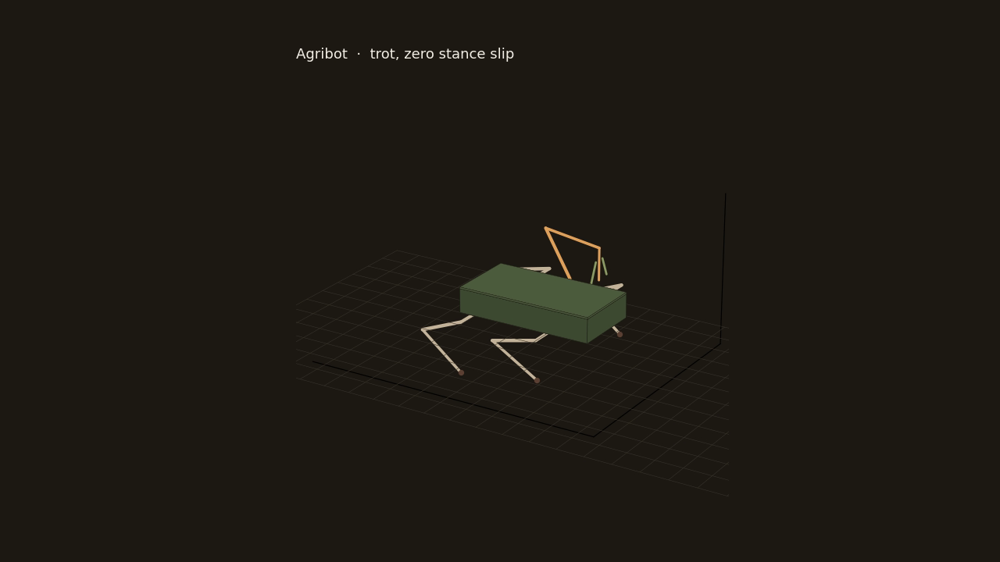
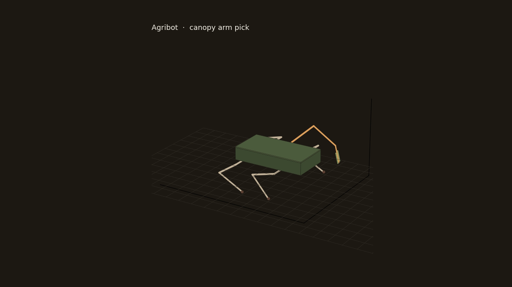

# Agribot MkI

A small field-scout quadruped with a 4-DOF canopy arm and a one-servo linkage gripper. The geometry, the inverse kinematics, the trot, and the bill of materials all come from one parameter file, so a link length cannot drift between the CAD and the controller.

The robot is meant to be printed on a 220 mm bed (PETG structure, TPU feet) and driven with fifteen DS3225-class servos plus two micro servos.





| | |
|---|---|
| Body | 200 × 108 × 44 mm tub |
| Track | 236 mm |
| Overall, servos included | about 266 × 308 × 266 mm standing, arm stowed |
| Leg | abad 52 mm, femur 70 mm, tibia 86 mm |
| Arm | yaw stack 32 mm, humerus 90, forearm 84, tool 58 |
| Stand height | body centre 104 mm, foot centre on an 11 mm ball |
| Stance slip | 0 mm/s in the straight trot (body frame) |

## Layout

```
spec/parameters.py      single source of truth (millimetres)
kinematics/             closed-form leg IK, arm IK, gripper four-bar, trot
cad/                    CadQuery solids — every printed and purchased part
export/step             one STEP per part, plus agribot_assembly.step
export/stl              matching binary STL
export/manifest.json    volume, mass, bounding box
bom/                    roll-up with filament mass and hobby prices
sim/                    trot and pick mp4s rendered from the IK
qa/                     gates and the horn-zero table
docs/                   assembly order and the kinematic notes
```

## Regenerate

```bash
pip install -r requirements.txt
python -m kinematics.test_kinematics
python -m cad.export_all
python -m sim.render_sim
python -m qa.run_qa
```

`qa/run_qa.py` is the acceptance gate: STEP headers, STL triangle counts, 220 mm bed, assembly bounds, IK residual, joint travel, gripper throw, and the videos. It rewrites the BOM from the solid volumes.

## Kinematics, short version

Legs are 3-DOF. Abduction is about X, hip and knee pitch about the post-abad Y axis. Knee angle 0 is straight; the crouch we use is negative. The hip angle is the exact solution of the 2×2 system in `sin q2, cos q2` after the law of cosines, not a search.

The arm is yaw plus a 2-link planar chain. Wrist pitch is chosen (level, or straight down for a pick) and the shoulder and elbow are solved with the elbow kept above the shoulder–wrist line so the arm clears the deck.

The gripper is one four-bar. Servo 0° is the closed stop (about 11 mm between the pads). Servo −35° opens it to about 49 mm. Both stops assemble; the branch is the outboard intersection of the horn circle and the crank circle.

Details and the servo horn zeros are in [docs/KINEMATICS.md](docs/KINEMATICS.md). The build order is [docs/ASSEMBLY.md](docs/ASSEMBLY.md).

## What is not in the solids

Silicone wire, a 30 A fuse, and an XT30 pigtail are consumables in the BOM. They are not modelled. Servo current stays off the UBEC: the pack feeds the servo rail through the fuse, and the UBEC feeds only the computer and the PCA9685 logic.

## Licence

Code and the CAD in this repository are released under the MIT licence. See [LICENSE](LICENSE).
